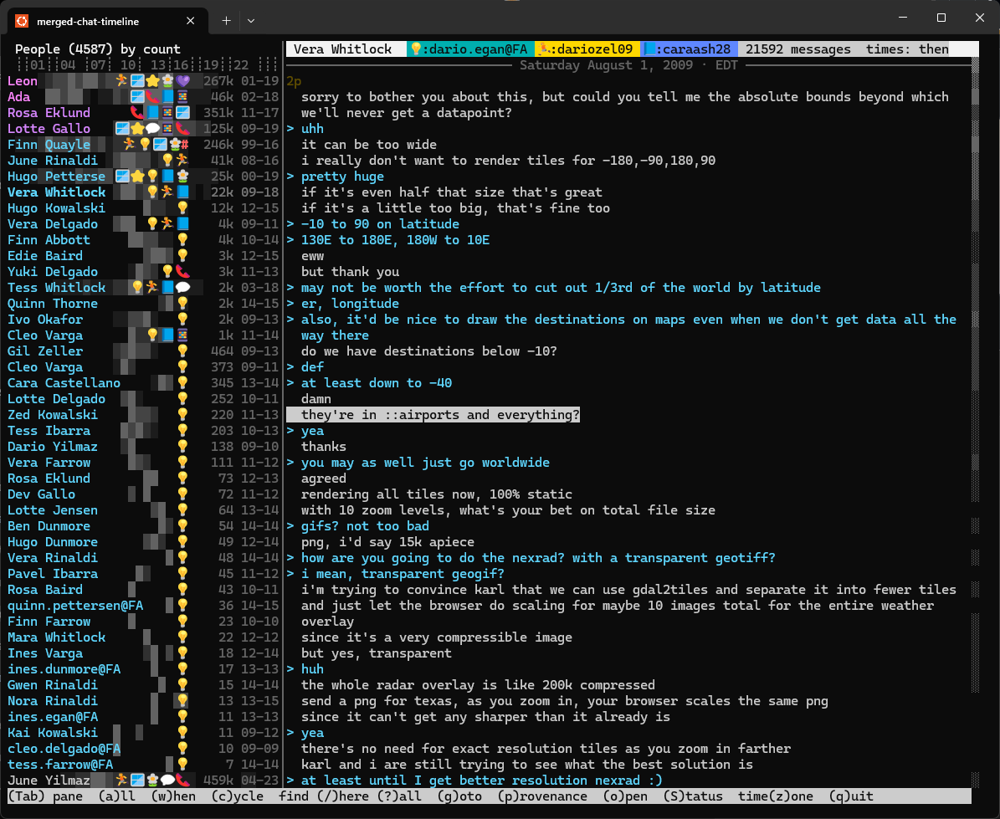

# Merged chat timeline

Twenty years of messages end up as a mess: Trillian logs from four computers, their XML sidecars, a server history
export, Digsby and Windows Messenger folders, pasted MSN windows, an ICQ database, WhatsApp, Discord, Instagram and
Twitter exports, the same conversation saved three times. This reads all of it into one index, merges every copy of
a message into one that remembers its sources, and puts everyone on one timeline: the people you talked to, across
every network, in the local time you lived in then.



```
pip install .                             # or run in place: python3 -m chattimeline ...
cp examples/archive.toml ~/ChatLogs/      # describe your folders, names and time zones
merged-chat-timeline files ~/ChatLogs     # what each source picks up, and what nothing does
merged-chat-timeline import ~/ChatLogs    # build the index (minutes; reads only, writes only the database)
merged-chat-timeline view ~/ChatLogs
```

Python 3.11+, no dependencies. Works anywhere curses does; under WSL links and files open in Windows.

Everything stays on your machine. The index holds every message in plain text, so it goes where `archive.toml`
says (`database = ...`), somewhere private; nothing is sent anywhere.

## What it understands

| format | what |
|---|---|
| `trillian` | Trillian `.log` files (all versions), XML sidecars, the Trillian server history export, cloud caches, Trillian/mIRC IRC logs, old mIRC buffer logs |
| `digsby` | Digsby HTML logs, old and new |
| `wlm-xml` | Windows Live Messenger message history XML |
| `msn-paste` | text copied out of MSN Messenger windows ("Name says:") |
| `whatsapp` | WhatsApp "Export chat" text, and `[time] jid: text` dumps |
| `icqdb-json` | ICQ 99a–2003a databases decoded by [icqdb-decoder](https://github.com/Lucent/icqdb-decoder) |
| `icq-history-txt` | the ICQ client's own "History Log" text export |
| `skypelogview-xml` | SkypeLogView XML |
| `discord-html` | DiscordChatExporter HTML |
| `sms-eml` | phone texts saved as e-mail |
| `reddit` | Reddit's data export: your comments and posts as two conversations, private messages, chat |
| `bluesky` | a Bluesky repo exported to JSON: your posts |
| `instagram` | Instagram "Download your information" (2019 JSON and the HTML exports), packed or not: messages, your posts and comments |
| `tiktok` | TikTok's export, JSON or TXT: direct messages and your comments |
| `twitter` | a Twitter/X archive: direct messages, group chats and your tweets; the ids it uses are named through a `users.tsv` (below) |
| `tinder` | Tinder's `data.json`: your side of each match's chat |

Exports can sit outside the archive folder (`root = "../Backup/reddit"` on a source) and stay packed: a `.tar.xz`
or `.zip` is read as a stream at import time, never unpacked.

The quirks that make old logs hard are handled: Facebook and Astra replaying history into Trillian logs with the
original times (and the wrong day), Trillian versions that mark every message of a session "outgoing", server
exports that store messages twice, logs written in a wall-clock zone with no zone noted, Trillian sessions that run
past midnight, ICQ's text export cutting years to fit a column, Windows Messenger file names that glue an account
number onto the login.

Twitter's archive names the people you messaged only by numeric id. Put a `users.tsv` next to the exports (`id`,
`handle`, `full name` per line, tab-separated) and name it on the source (`names = "users.tsv"`). Your own tweet
mentions and likes give some ids; for the rest, `https://x.com/i/user/<id>` answers with a redirect to the current
handle for a live account and 404 for a gone one.

## Time

Most old logs record only the wall clock of the computer that wrote them, with no zone. `wall_clock` in
`archive.toml` names that zone, so those times become real instants and line up with exports that carry UTC. The
`then` timeline says where you lived from each date on; the viewer shows every message in that local time, so a
message at 23:40 was late at night for you, whichever side of the world it was sent from. `z` cycles between then,
the wall-clock zone and UTC.

## Merging copies

Two copies are the same message when they belong to the same conversation, their text is identical after
whitespace and link normalization, their times agree (allowing for a wall-clock log being whole hours off), and
they come from different files. A merged message keeps the most precise time and the best-looking text; press `p`
in the viewer to see every copy and where it came from.

## People

Accounts are grouped into people with `people.tsv` next to `archive.toml`:

```
Jane Doe	aim:janedoe1999
Jane Doe	msn:jane.doe@hotmail.com
Jane Doe	facebook:100004567890123
```

The viewer reads it at start-up, no rebuild. The importer reads it too: two accounts of one person on the same
network (a renamed account, an id and a name) are folded into one conversation, so copies of a message exported
under both names merge; that part takes a rebuild.

People can be grouped with `groups.tsv` (see `examples/groups.tsv`): family, work, school. The People list is ordered
by group, and names take the group's colour, in the list and in the everyone-by-time view. A member is a person from
`people.tsv` or a `network:contact` pattern, so `jabber:*@corp.example.com` groups a whole company.

`merged-chat-timeline suggest` proposes groupings from metadata only: handles that match across networks, accounts that
received the same long messages, shared display names, one account going quiet as another starts. Names that mean
you go in `[me]` in `archive.toml` or in `me.tsv`. Both files are read when the viewer starts; no rebuild needed.

## The viewer

- People (or channels) on the left, each with an activity band: a shaded strip across the row showing when, and
  how much, you talked, on one time scale for everyone. A year ruler sits above; click a year to jump there.
- The conversation on the right in your local time *then* (a timeline of where you were), with day lines, hour
  marks, a faint line where a conversation paused, "— 2 years later —" where it stopped for a long time, and a
  divider where it moved to another network.
- A scrollbar map down the right edge: message density over the conversation's lifetime, the part on screen, and
  search hits. Click it to go there.
- `a` shows everyone at once, by time; `w` jumps there from the selected message, to see who else you were talking
  to that night. Enter opens that person at that message.
- `/` full-text search within the open person (accent-insensitive), `?` across everyone, `n`/`N` through hits,
  `g` go to a date.
- Sign-on and away notices fold into one line (`S` shows them).
- Links are underlined and clickable (OSC 8: ctrl+click in most terminals), and media links open the local
  downloaded copy when there is one.

## License

MIT.
